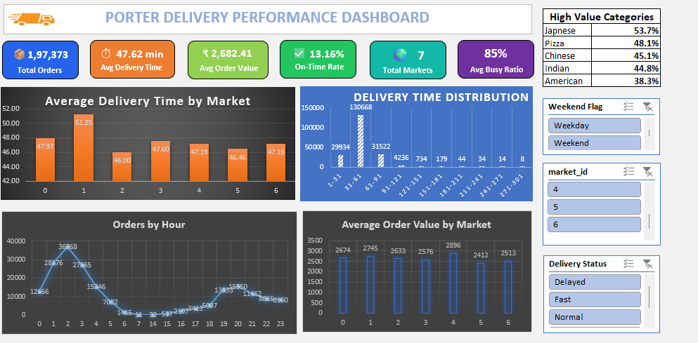

Porter Delivery Time Analysis — Excel
Project Overview

Analyzed 197,373 Porter delivery orders to identify factors affecting delivery time, order value, and operational efficiency.
Evaluated delivery performance, order complexity, partner utilization, pricing, and store-category trends.
Generated actionable business insights to support delivery optimization, partner utilization, and revenue strategies.
Dataset

Dataset: Porter Delivery Dataset
Records: 197,373 orders
Columns: 14
Time Period: January 2015 – February 2015
Tool: Microsoft Excel 2019
Data Cleaning

Removed duplicate records and verified data consistency.
Checked missing values across important fields.
Validated date and time formats and delivery-time calculations.
Identified approximately 790 records with inconsistent negative price ranges.
Identified and reviewed negative partner-availability values as data-quality issues.
Feature Engineering

Created Order Hour and Order Day features from order timestamps.
Created Month and Weekend Flag for time-based analysis.
Calculated Price Range using minimum and maximum item prices.
Created Busy Ratio to measure delivery-partner utilization.
Classified orders into On-Time and Delayed delivery statuses.
Business Analysis

Analyzed order distribution across markets, store categories, hours, and weekdays.
Evaluated delivery-time distribution and on-time delivery performance.
Analyzed the relationship between total items, distinct items, and delivery time.
Compared average order value across markets and store categories.
Evaluated the impact of partner availability and utilization on delivery performance.
Analyzed order complexity and item price ranges against delivery time and order value.
Compared delivery-time trends and variability across markets and categories.
Evaluated the efficiency of different order protocols.
Key Findings

Average delivery time:** 47.62 minutes.
Most orders were delivered within 31–61 minutes.
Delivery times remained relatively stable across weekdays.
Total Items vs. Delivery Time: weak positive correlation of 0.118.
Distinct Items vs. Delivery Time: weak positive correlation of 0.156.
Price Range vs. Subtotal: moderate positive correlation of 0.510.
Japanese, Pizza, Chinese, and Indian categories had the highest proportion of above-average-value orders.
Market 1 showed the highest delivery-time variability.
Afghan, Tapas, and Convenience Store categories showed relatively high delivery-time inconsistency.
High delivery-partner utilization did not always lead to slower deliveries, indicating that operational efficiency is more important than partner availability alone.
First-time vs. repeat customer analysis could not be performed because **customer identifiers were unavailable.
Excel Functions Used

IF()
COUNTIF()
CORREL()
AVERAGE()
STDEV()
MIN()
MAX()
HOUR()
TEXT()
